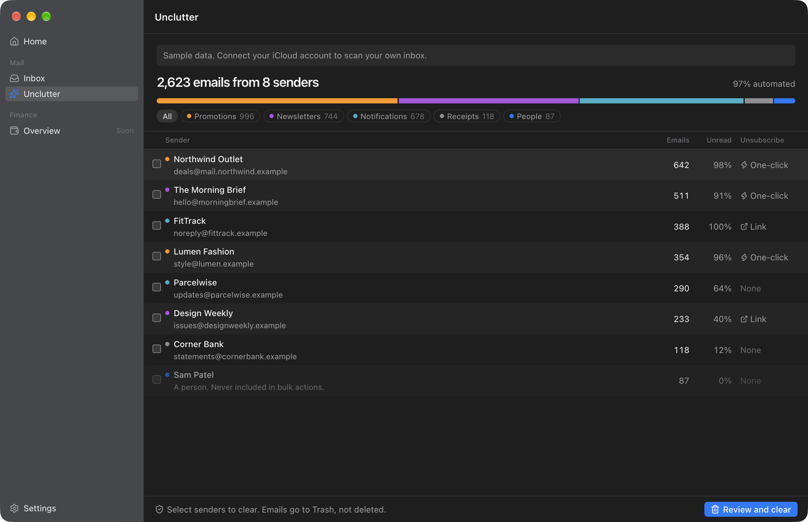

<p align="center">
  
</p>

<h1 align="center">Ordo</h1>

<p align="center">
  A calm, private desktop app for your personal admin. Mail first, with <b>Unclutter</b> built in.
</p>

<p align="center">
  <a href="https://github.com/NathanWalash/ordo/actions/workflows/ci.yml"></a>
  <a href="https://github.com/NathanWalash/ordo/releases"></a>
  
  <a href="LICENSE"></a>
</p>

<p align="center">
  
</p>

> **Early days.** You can connect iCloud, read, search and write mail, see who’s filling your inbox, and
> unsubscribe and clear senders with a review step and undo. See the [roadmap](#roadmap).

## Why Ordo

Inboxes fill up with years of newsletters, promotions and notifications you never
asked to keep. Ordo shows you who's filling yours, lets you unsubscribe and clear
them in a couple of clicks, and grows into a home for the rest of your personal admin.

- **Native feel.** Frosted sidebar and inset window controls on macOS, Mica on Windows 11, your system font and accent colour, light and dark mode.
- **Private by design.** Your mail, passwords and sorting stay on your machine. Sorting can use a local model through LM Studio or Ollama, or your existing Claude or ChatGPT login.
- **Safe.** Nothing changes without a review step. "Delete" means move to Trash, so you have 30 days to change your mind. Mail from real people is never included in bulk actions.

## Features

|                                                                              | Status |
| ---------------------------------------------------------------------------- | ------ |
| Home screen and module sidebar                                               | Done   |
| Unclutter preview with sample data                                           | Done   |
| Light, dark or system theme, with frosted glass surfaces                     | Done   |
| Connect iCloud (app-specific password in the Keychain)                       | Done   |
| Scan inbox headers and group by sender                                       | Done   |
| Sort senders with rules                                                      | Done   |
| AI settings: LM Studio, Ollama, Claude Code or Codex CLI, with a test        | Done   |
| Sort with AI in Unclutter: a model sorts the senders in Other                | Done   |
| One-click unsubscribe (RFC 8058) and move to Trash, with a review step       | Done   |
| Unsubscribe button per sender, keeping its mail; shows Unsubscribed after    | Done   |
| Unclutter clean-up history with undo                                         | Done   |
| Assistant (⌘K): your data and general questions; changes need a confirm card | Done   |
| Mail client: folders, reading with a safe HTML view, search, flags           | Done   |
| Mail client: write, reply, forward and drafts through iCloud SMTP            | Done   |
| Calendar: iCloud calendars in month, week and agenda views                   | Done   |
| Calendar: subscribe by link (Google, Outlook, webcal) or import .ics         | Done   |
| Create and edit calendar events                                              | Done   |
| Money: import bank statement CSVs, spending by category and month            | Done   |
| Money: find bills and subscriptions in statements and email receipts         | Done   |
| Money: split bills with flatmates, balances and settling up                  | Done   |
| Money: bill due dates, renewals and trial ends on the Calendar               | Done   |
| Money: Sort with AI for categories and matching bills to email               | Done   |
| Money: change a transaction's category yourself                              | Done   |
| Money: HSBC and Monzo app exports; transfers between your accounts           | Done   |
| Money: Ask Ordo, which learns how your money works (exploratory)             | Done   |
| Money: charts of money in and out, categories and your usual month           | Done   |
| Headless mode: a CLI and an MCP server for scripts and AI agents             | Done   |
| Boards: local kanban with drag and drop, custom fields and templates         | Done   |
| Boards: link cards to events, emails, bills and cards; due on Calendar       | Done   |
| Boards: Suggest with AI (due date, checklist, labels and links)              | Done   |

## Headless mode and MCP

Ordo also runs without a window, for scripts, tests and AI agents. It uses the same saved account,
data and safety checks as the app, and is read-only unless you start it with `--allow-changes`
and confirm each change.

```bash
/Applications/Ordo.app/Contents/MacOS/Ordo --headless status
/Applications/Ordo.app/Contents/MacOS/Ordo --headless senders --category promotions --json
/Applications/Ordo.app/Contents/MacOS/Ordo --headless cleanup plan --sender deals@shop.example
```

As an MCP server over stdio for Claude Code or Claude Desktop:

```bash
claude mcp add ordo -- /Applications/Ordo.app/Contents/MacOS/Ordo --headless --mcp
```

From a checkout, `pnpm build` once, then `pnpm ordo -- status`. Commands, JSON output, MCP setup and
the safety model are in [docs/headless.md](docs/headless.md).

## Install

Installers for macOS, Windows and Linux are attached to each
[release](https://github.com/NathanWalash/ordo/releases). Builds aren't code-signed yet, so the first time you open Ordo:

- **macOS:** right-click Ordo in Applications and choose **Open**.
- **Windows:** on the SmartScreen prompt, choose **More info**, then **Run anyway**.

## Development

You need Node 22+ and pnpm.

```bash
pnpm install
pnpm dev          # run the app with hot reload
pnpm check        # format check, lint, typecheck, unit tests
pnpm test:e2e     # build and run Playwright tests against the real app
pnpm imap:start   # local IMAP test server (Docker), then:
IMAP_TEST_PORT=3143 pnpm test:integration
pnpm caldav:start # local CalDAV test server (Docker), then:
CALDAV_TEST_PORT=5232 pnpm test:integration
pnpm package      # build an installer for your OS into apps/desktop/release
```

### How it fits together

```
apps/desktop          Electron app
  src/main            Main process: windows, IPC handlers, IMAP, CalDAV and SQLite
  src/main/headless   The same services without a window: CLI and MCP server
  src/preload         Exposes a small, typed API to the UI as window.ordo
  src/renderer        React UI (Tailwind CSS)
packages/shared       Module registry and the typed IPC contract
packages/mail-core    Mail logic with no Electron dependency, fully unit-tested
packages/ai           Model providers (LM Studio, Ollama, Claude Code and Codex CLIs)
packages/calendar-core  CalDAV and calendar links, iCalendar parsing and recurrence, calendar cache and layout
packages/money-core   Bank statements, bills, splits and Money's AI sorting
packages/boards-core  Kanban boards: ordering, store, fields, notes, filters, links and AI suggestions
e2e/                  Playwright tests that launch the built app
docs/design.md        Design decisions and roadmap
```

The renderer is sandboxed with no Node.js access. Everything that touches the
network, disk or credentials lives in the main process, behind the typed API in
`packages/shared`.

**Tech:** Electron, electron-vite, React, Tailwind CSS v4, TypeScript, Vitest,
Playwright, electron-builder, pnpm workspaces.

## Roadmap

1. **Unclutter for real:** iCloud connection, header scan into SQLite, rule and model-based sorting, review, unsubscribe, move to Trash, history.
2. **Reading mail (done):** folders, a safe HTML reader with remote images blocked, search. Conversation threads are next.
3. **Writing mail (done):** compose, reply, reply all, forward, drafts, attachments.
4. **Finance** and other modules. Money and Boards are in; see [docs/boards.md](docs/boards.md).
5. **Money that learns** (exploratory): Ask Ordo answers questions about your money with Ordo's own
   sums, asks short questions with one-tap answers, and remembers what you tell it: paybacks, money
   you hold for others, events and trips, who owes you. Next: richer editing of what Ordo knows,
   events from calendar entries, and reconciling settle-ups with paybacks.

How the mail client keeps you safe, and its keyboard shortcuts, are in [docs/mail.md](docs/mail.md). More detail in [docs/design.md](docs/design.md). How AI sorting works, and what it sends, is in [docs/ai.md](docs/ai.md). The assistant, its tools and its safety design are in [docs/assistant.md](docs/assistant.md).
Boards are described in [docs/boards.md](docs/boards.md).

## Contributing

Issues and pull requests are welcome. See [CONTRIBUTING.md](CONTRIBUTING.md). For
security issues, see [SECURITY.md](SECURITY.md).

## Licence

[MIT](LICENSE) © Nathan Walsh
