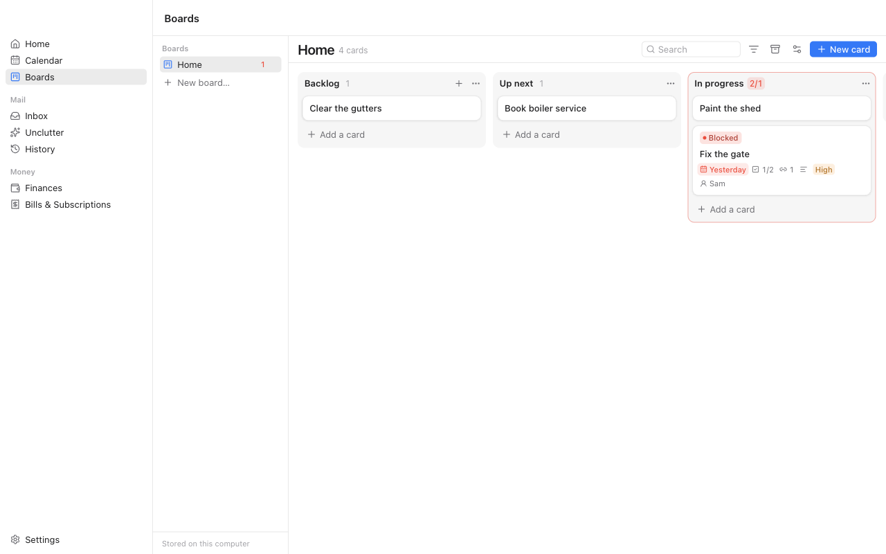

# Boards

Boards are local kanban boards: columns of cards you drag between, for to-dos, weekly plans and
projects. Everything is kept on this computer, in its own SQLite file (`boards.sqlite` in Ordo's
data folder). Nothing is uploaded.

  

## Boards, columns and cards

- **Boards** are listed on the left. Make one with **New board…**, from a template: **Simple**
  (To do, Doing, Done), **Weekly plan** (a column a day, the weekend and Done, with an Effort
  field) or **Project** (Backlog to Done, with Priority, Owner, Estimate and Link fields).
  Rename, reorder and delete boards from the menu on each one.
- **Columns** can be added, renamed, reordered and deleted. A column can have a **card limit**:
  over it, the column turns red. Nothing is blocked. A column marked **Cards here are done** (the
  templates' Done) stops its cards being overdue and keeps them off the Calendar.
- **Cards** have a title, notes, labels, a due date or a date range, a checklist and the board's
  custom fields. Notes take simple markdown (bold, italic, code, lists, task lists, quotes,
  headings and https links); they're drawn without any HTML, so nothing in them can run.
- **Custom fields** are set per board under **Labels and fields**: text, number, date, choice
  (with coloured options), checkbox, link (https only) and person. Fields marked **On card** show
  on the card in the board.
- **Archive** a card to take it off the board without deleting it; **Archived cards** in the
  toolbar restores it. **Delete** shows **Undo** (or ⌘Z) straight afterwards. Deleted boards,
  columns, cards, labels, fields and steps are removed for good a day later.

### Moving things

Drag cards between and within columns, and columns by their header. Escape cancels a drag.

| Keys                     | On a card                                        | On a column header  |
| ------------------------ | ------------------------------------------------ | ------------------- |
| Return                   | Open the card                                    | Rename              |
| ↑ ↓ ← →                  | Move focus to the next card                      | ↓ goes to its cards |
| ⌥↑ ⌥↓                    | Move the card up or down                         |                     |
| ⌥← ⌥→                    | Move the card to the column on the left or right | Move the column     |
| Delete                   | Delete the card (with undo)                      |                     |
| Shift-F10 or right-click | The card's menu: move, move to a column, archive | The column's menu   |

In the board list, ⌥↑ and ⌥↓ reorder boards. In a checklist, ⌥↑ and ⌥↓ reorder steps. ⌘F
searches the board. Moves are announced to VoiceOver.

**Search** matches every word against titles, notes, labels and field values, ignoring case and
accents. **Filter** narrows by labels, dates (overdue, due today, due in the next week, has a
date, no date) and choice, person or checkbox fields. Drag and drop and keyboard moves still work
while filtering; a card dropped between two visible cards lands between them.

### Ordering

Every board, column, card, step, label and field has a fractional rank: a short base-62 string,
sorted as plain bytes. There is always room between two ranks, so moving a card rewrites only that
card. Adding at the end steps along in small increments, keeping ranks two characters long for
thousands of cards; if a list's ranks ever get long (hundreds of moves into the same spot) or
broken, it's renumbered evenly. See `packages/boards-core/src/rank.ts` and its tests.

## Links to the rest of Ordo

A card can link to a **calendar event** (one occurrence, by its calendar, UID and start), an
**email** (by mailbox and UID, from Mail's cached headers), a **bill** or a **payment** from Money,
or **another card**. Use **Link…** on the card and search. A link keeps a snapshot of the title and
date, and is looked up again whenever the card opens: if the event, email or bill has gone (or Mail
was disconnected), the link stays and says **Not found on this computer**. A card linked from
another shows it under Links as **Links here**.

Cards with a due date or date range show on the **Calendar** as a **Boards** overlay, drawn like
Money's bills so they never look like events. Clicking one offers **Open in Boards**. From an
event's popover, **Create card from this…** makes a card with the event's title, due on the day (or
the day before), linked to the event.

## Suggest with AI

**Suggest** on a card asks the model chosen in **Settings → AI** for:

- a due date, optionally based on one of the candidates (say, the day before an event);
- a checklist breaking the task into steps;
- labels from the board;
- links to related upcoming events, bills, recent emails and other cards.

Ordo gathers the candidates itself: events and bills in the next 60 days, emails from the last 30
days and the other cards, kept to a few of each, related ones first (shared words, and dates close
to the card's). Emails and cards are only sent when they share words with the card. The model is
given short ids (`e1`, `b2`, `m1`, `c3`, `l1`) and may only choose among them; it never sees Ordo's
own ids. The reply must match a strict schema; dates must be real and from today on, ids must be
ones that were sent, and steps are cleaned and cut to 120 characters. Anything else is dropped.

Nothing changes until you press ✓ on a suggestion (or **Add all**); ✕ dismisses it. The panel says
which model answered and how many related items went with the card. What is sent, and how, is in
[ai.md](ai.md#boards). Suggest uses the same provider, model and cloud consent as everything else;
a cloud provider is only used after you've agreed to it in Settings.

## Headless and agents

`boards list`, `boards cards`, and (with `--allow-changes` and `--confirm`) `boards add-card` and
`boards move-card`, plus the MCP tools `ordo_boards`, `ordo_board_cards`, `ordo_board_add_card` and
`ordo_board_move_card`. Boards, columns, labels and cards can be named rather than given by id. See
[headless.md](headless.md#boards).

## For developers

- `packages/boards-core`: pure logic with no Electron: ranks, templates, field checks, the
  markdown reader, search and filters, link candidates and resolution, calendar items and the
  Suggest prompt and reply checks. `@ordo/boards-core/node` has `BoardsStore` (SQLite), which
  checks every write (names, dates, labels and fields belong to the board, limits), so the app,
  headless mode and agents get the same rules.
- `apps/desktop/src/main/boards.ts`: the service. Each function takes unchecked input, validates
  it with the zod schemas in `packages/shared/src/boards.ts`, and takes the write lock for changes.
  `findBoard`, `findColumn`, `findCard`, `cardsByRef`, `addCardByRef` and `moveCardByRef` resolve
  names for headless mode and an in-app assistant.
- `window.ordo.boards` has one IPC channel per method, `boards:<method>`.
- The renderer is in `apps/desktop/src/renderer/src/components/boards` and `pages/BoardsPage.tsx`.

## Limits

- Boards are on this computer only: no sync between machines and no sharing.
- An email link uses the mailbox and UID from Mail's cache. If the mailbox is rebuilt on the server
  (a new UIDVALIDITY), old email links show as not found. The `messageId` field is stored when
  known; Mail doesn't record Message-ID headers yet.
- Links to calendar events point at one occurrence; moving the event on the server breaks the link.
- Up to 200 boards, 50 columns, 5,000 cards, 50 labels and 30 fields a board, 200 steps and 100
  links a card.
- Card limits are a warning, never enforced.
